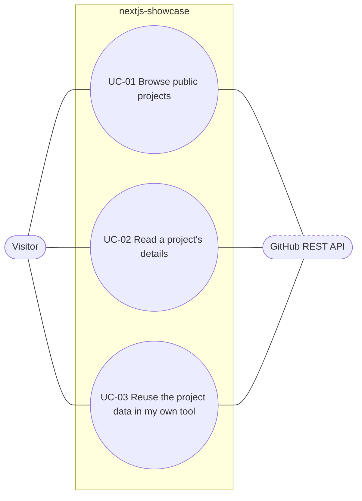

# Use case diagram — dashboard

The goals a visitor reaches on the GitHub projects dashboard (ADR-0001). Mermaid has no use case
notation; this flowchart approximates it, GitHub being a secondary actor.

| ID | Goal | Primary actor | Notes |
|---|---|---|---|
| UC-01 | Browse the owner's public repositories, sorted by last push | Visitor | Shell + streamed list (CSP spike may make it dynamic) |
| UC-02 | Read one repository's description, languages and recent releases | Visitor | Paths prebuilt with `generateStaticParams` |
| UC-03 | Reuse the project list in my own tool | Visitor (developer) | Route Handler `GET /api/projects` |
