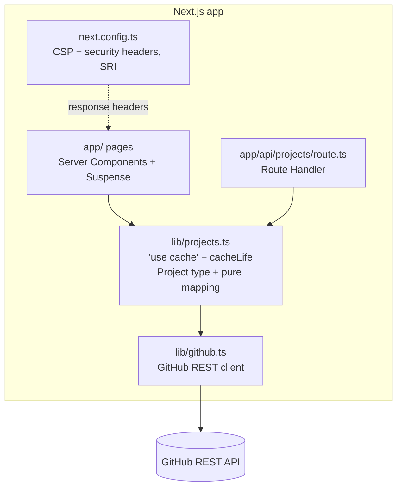

# Component diagram — dashboard

The parts of the application and their dependencies; only `lib/github.ts` touches the network.

`lib/projects.ts` holds the `Project` type and a pure mapping from GitHub payloads, unit tested
without network; a separate domain module waits until a second data source exists (KISS). `lib/github.ts` is the only module that calls `fetch`.
