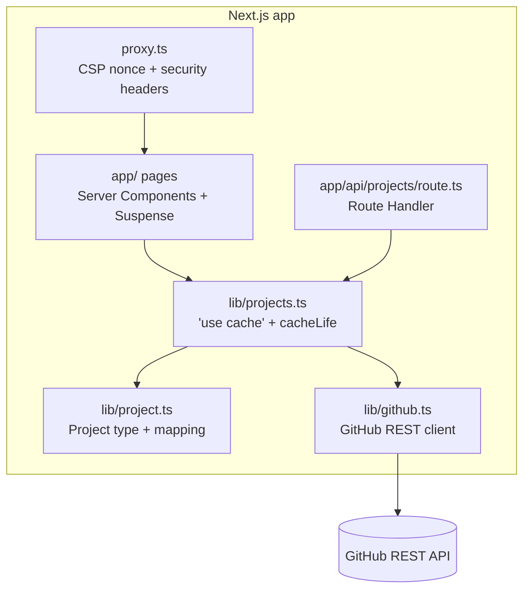

# Component diagram — dashboard

The parts of the application and their dependencies; the domain never imports the GitHub client.

`lib/project.ts` holds the `Project` type and the pure mapping from GitHub payloads; it is unit
tested without network. `lib/github.ts` is the only module that calls `fetch`.
