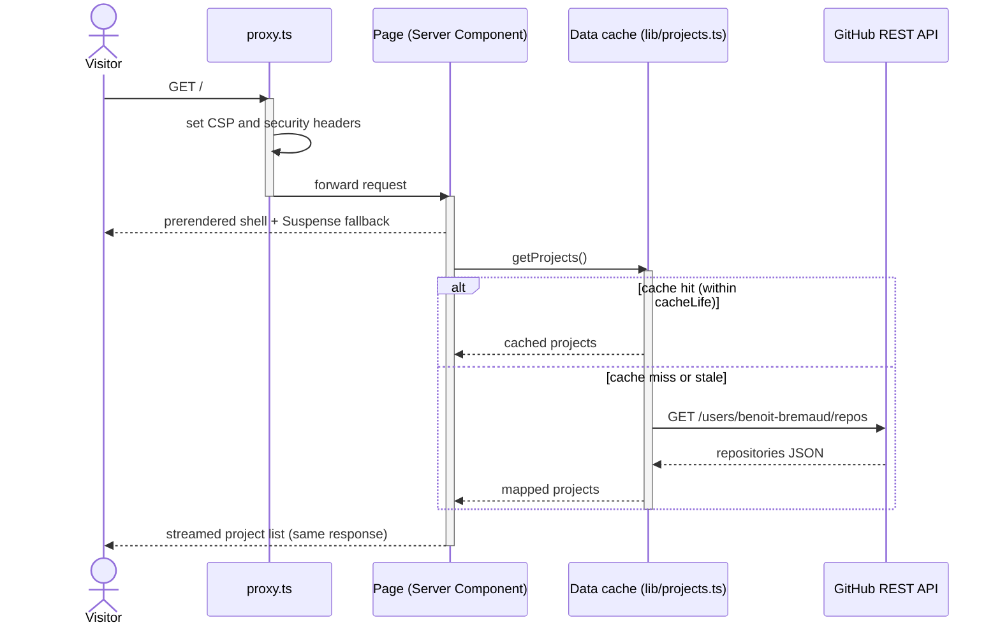

# Sequence diagram — UC-01 Browse public projects

How a request is served with Partial Prerendering and the data cache. Provisional: it shows the
prerendered variant (hash-based CSP); the CSP spike of ADR-0001 may make the route fully dynamic
with a nonce, in which case the shell is rendered per request.

If GitHub fails, `error.tsx` renders a retry message; no stale data is invented.
