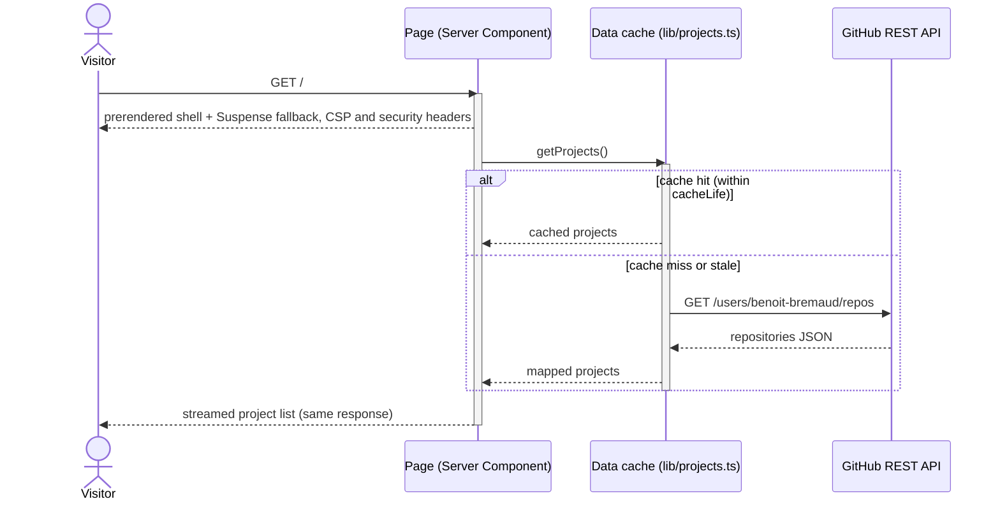

# Sequence diagram — UC-01 Browse public projects

How a request is served with Partial Prerendering and the data cache. The CSP and security headers
are static, set in `next.config.ts` (ADR-0001, amendment 1).

If GitHub fails, `error.tsx` renders a retry message; no stale data is invented.
