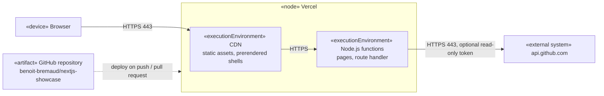

# Deployment diagram — dashboard

Where the application runs (ADR-0001: Vercel Hobby).

| Tier | Trigger | URL |
|---|---|---|
| staging | each pull request (Vercel preview) | `*.vercel.app` preview URL |
| prod | merge to `main` | Vercel production URL (custom domain decided later) |
